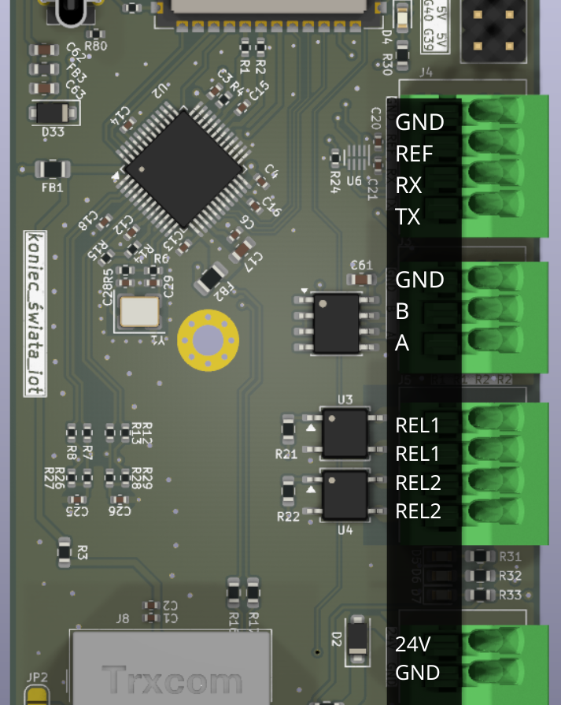

# Koniec Swiata IoT hardware

This document describes the board connectors, power path, and onboard
interfaces. GPIO assignments and ESPHome behavior are also summarized in
`README.md`; example configurations are under `examples/`.

The overlaid labels in the picture show the terminal order. Always compare the
actual board revision and silkscreen with this document before applying power.
Turn off power while changing terminal wiring.

## Connector overview

| Connector group | Terminals shown | Main use |
| --- | --- | --- |
| Level-shifted UART | GND, REF, RX, TX | General serial devices, including direct Panasonic/HeishaMon-style communication |
| RS485 | GND, B, A | Modbus RTU, Hormann HCP, and other RS485 buses |
| Solid-state relays | REL1, REL1, REL2, REL2 | Momentarily short low-voltage control inputs |
| Board power | 24V, GND | Main 12-24 V DC input |

## Level-shifted UART: GND, REF, RX, TX

This connector is a non-isolated logic-level UART built around a TXS0102
bidirectional voltage-level converter. Its ESP32-S3 signals are:

| Terminal | Board function |
| --- | --- |
| GND | Signal ground/reference shared with the external device |
| REF | External-side logic reference voltage |
| RX | Board receive data, connected to ESP32-S3 GPIO4 |
| TX | Board transmit data, connected to ESP32-S3 GPIO5 |

Cross data when connecting two UART devices: board TX goes to the other
device's RX, and board RX goes to the other device's TX.

### Selecting REF

`REF` sets the logic-high voltage on the external side of the TXS0102. A
solder bridge can connect it to either the board's 5 V or 3.3 V rail. The
default assembly is 5 V. Choose the voltage expected by the attached device;
using the wrong reference can prevent communication or damage hardware.

For a different reference voltage, clear the onboard bridge and supply `REF`
externally. Never bridge 5 V and 3.3 V at the same time. Never drive `REF`
externally while a bridge still connects it to an onboard supply. Verify the
bridge with a meter before connecting an unfamiliar device.

### Why GND must be shared

This interface is not galvanically isolated. The voltage on RX and TX is
measured relative to GND, so the board and the external device must agree on
what zero volts means. Connect their signal grounds together using the GND
terminal. Without that connection, RX and TX can float relative to each other:
logic highs and lows may be misread, communication may be intermittent, and a
large ground-voltage difference may stress the electronics.

Sharing GND also means electrical noise, ground loops, and fault voltage can
travel between the two devices. Keep this connection short and use it only
where the two systems can safely share a reference. Use an isolated interface
when the equipment is far away, powered from a different electrical system, or
requires galvanic separation.

### Panasonic and HeishaMon use

The onboard translated UART can be useful for direct Panasonic Aquarea
CN-CNT/HeishaMon-style communication when one serial channel and a shared
ground are acceptable. It provides level translation, but not isolation and
not a second serial path for the original Panasonic client.

The optional dual-UART HAT is the preferred arrangement for the repository's
Panasonic ESPHome example. It provides two galvanically isolated converters:

| HAT channel | ESP32-S3 pins | Purpose in the example |
| --- | --- | --- |
| UART1 | TX GPIO39, RX GPIO40 | ESPHome component to Panasonic CN-CNT |
| UART2 | TX GPIO41, RX GPIO42 | Passthrough for the original CZ-TAW1 or another Panasonic client |

The [`koniec_swiata_iot_panasonic_heat_pump.yaml`](examples/koniec_swiata_iot_panasonic_heat_pump.yaml)
configuration uses both channels so the ESPHome component can communicate with
the heat pump while forwarding traffic for the original client. Both UARTs are
configured for 9600 baud, 8 data bits, even parity, and 1 stop bit. Panasonic
CN-CNT uses 5 V signalling; do not connect it directly to ESP32-S3 GPIOs.

## RS485: GND, B, A

This terminal exposes the board's RS485 transceiver:

| Terminal | Board function |
| --- | --- |
| GND | Optional signal reference |
| B | RS485 differential bus line B |
| A | RS485 differential bus line A |

The ESP32-S3 side uses GPIO15 for TX, GPIO6 for RX, and GPIO7 for RTS/driver
enable. Firmware must toggle GPIO7 so the half-duplex transceiver knows when to
transmit and when to listen.

RS485 is the electrical layer commonly used by industrial controls, HVAC
equipment, meters, inverters, and building automation. Modbus RTU is one of
the most common protocols carried over it. RS485 sends data as the voltage
difference between A and B rather than as one signal measured only against
ground. A twisted pair and differential receiver reject much of the noise that
both wires collect together, making it substantially more robust than a
single-ended UART over longer cables and in electrically noisy locations.

Connect A to A and B to B. Some vendors unfortunately use the opposite A/B
naming convention; if electrical and serial settings are correct but no frames
are received, check both manuals and try swapping A and B. Use twisted pair,
avoid long branches, and install 120-ohm termination at the physical ends only
when required by the bus topology.

GND is not mandatory for the differential signal itself. It can provide a
useful common-mode reference, particularly over shorter runs, but it can also
create ground-loop current between separately powered equipment. Follow the
connected equipment's manual. For long runs, separate buildings, or uncertain
ground potential, use proper galvanic isolation rather than relying on the
optional GND wire.

In this project the connector is used by:

- [`koniec_swiata_iot_hormann_gate.yaml`](examples/koniec_swiata_iot_hormann_gate.yaml)
  for a Hormann gate motor through HCPBridge;
- [`koniec_swiata_iot_thessla_green.yaml`](examples/koniec_swiata_iot_thessla_green.yaml)
  for a Thessla Green AirPack4 through Modbus RTU.

Hormann HCP uses the same RS485-like physical interface but is handled by the
dedicated HCPBridge component, not by generic Modbus register entities.

## Solid-state relays: REL1/REL1 and REL2/REL2

The board has two normally-open solid-state relay outputs based on CPC1017
devices. Each pair is one isolated contact:

| Pair | ESP32-S3 control | ESPHome examples |
| --- | --- | --- |
| REL1 / REL1 | GPIO17 | Relay 1 button |
| REL2 / REL2 | GPIO16 | Relay 2 button |

When inactive, the two terminals in a pair behave like an open physical
switch. When activated, the pair is electrically joined, like pressing a
button. There is no COM/NO/NC selection and the two terminals within a pair
are the complete contact.

This has been validated for external gate controllers that provide dedicated
low-voltage push-button inputs. Wire one relay pair across the same two input
terminals used by the physical button. The ESPHome examples expose each relay
as a `button` and close it for 250 ms, so Home Assistant shows a press action
rather than a persistent on/off switch.

These are signal relays, not general-purpose power relays. Do not use them to
power a gate motor, switch mains voltage, or control a load whose voltage and
current have not been checked against the CPC1017 and board ratings. Confirm
the gate input is intended for a dry contact before connecting it.

## Main power: 24V and GND

The main two-pin terminal is labelled `24V` and `GND`. It accepts 12-24 V DC;
`24V` is the positive input and `GND` is the negative return. Check polarity
before applying power.

An LMR50410 buck converter generates the board's 5 V rail from the main input.
An AP7361C LDO then generates 3.3 V. The LDO uses a large ground pad for heat
dissipation and has been verified not to heat excessively in normal board use.

Three LEDs between the connectors indicate the presence of the 24 V, 5 V, and
3.3 V rails. They are useful for a quick power-path check, but an illuminated
LED does not prove that a rail is at the correct voltage or can deliver current.
Use a multimeter when diagnosing power problems.

## USB

The USB connector is wired directly to the ESP32-S3 native USB pins. Its main
documented purpose is programming, serial logs, and testing. The ESP32-S3 can
use native USB for other functions, but those are outside this project's
examples.

USB also powers the board's 5 V and 3.3 V rails, so it can theoretically power
the controller for light-duty use and bench testing without the 12-24 V input.
A diode in the USB supply path prevents the board's 5 V rail from feeding
current backward into the USB source. This does not increase the current
capability of a USB port; attached extensions and loads must remain within the
available USB and board power budget.

## Ethernet and WiFi

The onboard Wiznet W6100 provides wired Ethernet through SPI. The board and
driver support an SPI clock up to 80 MHz and have been validated at that speed.
The ESPHome component keeps a conservative 26.67 MHz default; add
`clock_speed: 80MHz` under `ethernet:` to select the tested higher speed. SPI
clock speed is not the same as Ethernet link speed.

Custom ESP32 software can bring up the W6100 and WiFi as separate network
interfaces. This repository's ESPHome component declares Ethernet and WiFi as
compile-time conflicts, so an ESPHome image must choose one before compilation.
It cannot automatically enable WiFi only after Ethernet disconnects. Use the
Ethernet examples or the dedicated WiFi-only example accordingly.

## Expansion GPIO header

The expansion header provides 24 V, 5 V, 3.3 V, several spare GPIOs, and direct
access to ESP32-S3 RX/TX as an emergency serial connection. It is intended for
small extension boards and development. Check the board silkscreen or schematic
for physical pin order before attaching anything; this document does not
define the header's connector numbering.

Include the current draw of an expansion board in the main or USB power budget.
ESP32-S3 GPIOs are 3.3 V logic and are not generally 5 V tolerant. The exposed
24 V pin is a supply rail, never a GPIO logic level.

## Other onboard hardware

- The board temperature sensor is an LM75B at I2C address `0x48`, with SDA on
  GPIO8, SCL on GPIO18, and an active-low alarm output on GPIO38.
- The status LED is controlled by GPIO48.
- W6100 status outputs are available on GPIO14 (`nCOL`), GPIO21 (`nDPX`), and
  GPIO47 (`nSPD`).
